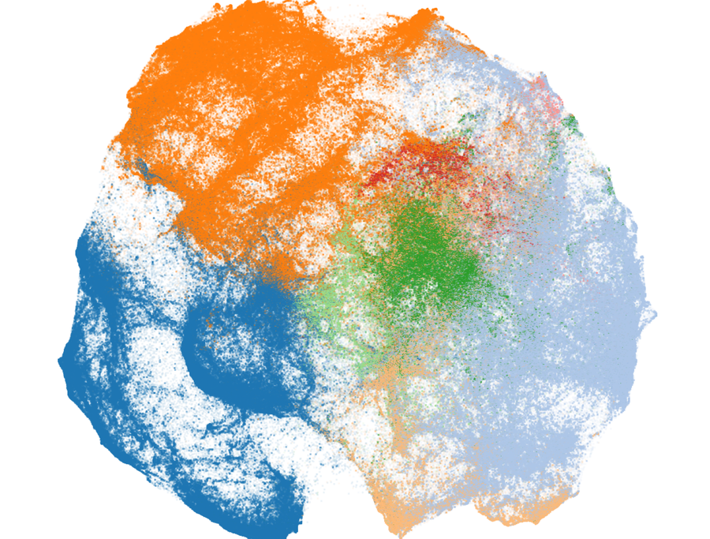

# IMSTE

[](https://doi.org/10.5281/zenodo.24307529)

<p align="center"></p>

**Iterated Minimum Spanning Tree Embedding (IMSTE)** is a scikit-learn
transformer for learning low-dimensional coordinates from feature vectors. It
builds a weighted graph from ranked minimum spanning trees, then optimizes one
coordinate vector per sample. Optional `.preprocessor(...)` presets accept raw
text, images, or graph objects and vectorize them before fitting IMSTE.

Browse the [documentation](https://imste.readthedocs.io/en/latest/) for getting started,
the estimator API, and feature guides.

The package has two explicit estimators: `IteratedMinimumSpanningTreeEmbedder`
learns coordinates for the training rows, while `InductiveIMSTE` also learns
an MLP that maps new rows into that space.

## Install

After the first PyPI release, install the core package with:

```bash
python -m pip install imste
```

From a source checkout:

```bash
python -m pip install .
```

For the PyTorch GPU optimizer, inductive estimator, and differentiable loss
functions, install the optional PyTorch extra:

```bash
python -m pip install "imste[gpu]"
```

From a source checkout, use `python -m pip install ".[gpu]"` instead.

CPU use does not require PyTorch; `device="auto"` falls back to the CPU
optimizer when PyTorch or a supported GPU is unavailable. For notebooks, install
the optional plotting and widget dependencies:

```bash
python -m pip install "imste[notebook]"
```

From a source checkout, use `python -m pip install ".[notebook]"` instead.

To embed raw text and images before fitting IMSTE, install the optional model
integration with `python -m pip install "imste[preprocessing]"`. The graph
preset needs NSPPK, installed from its repository with
`python -m pip install git+https://github.com/Xfcosta/NSPPK.git`. See the
[preprocessing guide](docs/preprocessing-guide.md) for built-in modality presets
and custom scikit-learn transformers.

To tune IMSTE against labeled 2D separation, install the optional Bayesian
optimization dependency with `python -m pip install "imste[tuning]"`.

Both estimators accept dense arrays and SciPy CSR matrices. The graph builders
keep CSR inputs sparse. `InductiveIMSTE` densifies only each MLP mini-batch.
The default FAMST graph builder uses RINND for dense Euclidean inputs and
PyNNDescent for sparse inputs. Both are core dependencies. The neighbor-search
backend can be selected independently from the optimizer's `device`; on dense
MPS inputs, exact chunked search is also available. To use only the exact Prim
builder, select `mst_method="prim"`.

For an existing sparse graph whose stored values are distances, use
`fit_graph()` or `fit_graph_transform()` instead of passing the matrix to
`fit()` (which treats rows as feature vectors). Supply a square SciPy sparse matrix with finite,
non-negative values. Each stored off-diagonal entry is an edge; implicit zeros
are absent edges, while explicitly stored zero-distance edges are retained.
Edges are treated as undirected, and reciprocal entries use the smaller
distance. Disconnected components remain separate spanning forests. Each
iteration prefers unused edges; when needed, it reuses short edges and
increments their rank. The optimizer uses the usual inverse-rank attraction
weights. With positive `label_strength`, pass `y` with one class label per
graph node to adjust those weights. Optionally pass `init_features` with one
feature row per graph node to seed the coordinates from standardized PCA
scores. These features affect only initialization; the supplied graph remains
the optimizer's objective. Without `init_features`, seeded random
initialization is used. Use `fit_graph()` when
you need the fitted estimator and `fit_graph_transform()` when you only need
the embedding array.

## Quick start

IMSTE uses Euclidean distance by default and also supports cosine distance
with `metric="cosine"`. Gravity is automatically skipped for cosine fits;
mean shift remains available. Scale features first when they have different ranges.
This small example uses scikit-learn's built-in
digits dataset, so it does not need a download:

```python
import matplotlib.pyplot as plt
from sklearn.datasets import load_digits
from sklearn.preprocessing import StandardScaler

from imste import IteratedMinimumSpanningTreeEmbedder

digits = load_digits()
X = StandardScaler().fit_transform(digits["data"])

mapper = IteratedMinimumSpanningTreeEmbedder()
embedding = mapper.fit_transform(X)

plt.scatter(embedding[:, 0], embedding[:, 1], c=digits.target, cmap="tab10", s=10)
```

### Detect outliers in an IMSTE embedding

`mapper.outliers()` uses the estimator's configured embedding dimension,
computes local outlier factor (LOF) scores from fast embedding-space neighbors,
and reports rows with no reciprocal links among their `k` nearest neighbors:

```python
from imste import IteratedMinimumSpanningTreeEmbedder

mapper = IteratedMinimumSpanningTreeEmbedder(n_components=10, n_epochs=100)
embedding = mapper.fit_transform(X)
result = mapper.outliers(k=20)
top_candidates = result.ranked_indices[:100]
outliers = result.outlier_indices
```

Higher `result.lof_scores` indicate lower local density relative to a sample's
neighbors. `result.mutual_neighbor_counts` gives the reciprocal-link count for
each input row, and `result.embedding` contains the fitted coordinates. See the
[MNIST outlier detection notebook](notebooks/mnist_outlier_detection.ipynb) for
a ranked image grid. The standalone `detect_outliers(X, ...)` convenience
function is also available when you want the helper to construct the estimator.

### Tune a labeled 2D embedding

`tune()` searches estimator parameters using a combined score of 60% mean 5-fold
k-NN accuracy and 40% robust spatial coverage. Coverage estimates how evenly
points occupy a robustly scaled 2D grid, so a few outliers cannot dominate it.
With `label_strength=0`, each trial fits an unsupervised embedding on all
feature rows and uses labels only for scoring. When `label_strength` is
positive, `tune()` masks each validation fold's labels while fitting a
transductive embedding over all feature rows, then scores that fold. This costs
about five embedding fits per trial. With no `search_space`, it tunes
`n_msts` (3–30), `learning_rate` (0.01–0.1), `negative_ratio` (1–10),
`gravity_strength`
(0.0–1.0), and `mean_shift_iterations` (0–5). Set `coverage_weight=0` to
optimize accuracy alone. A two-number tuple gives inclusive numeric bounds;
the estimator's declared default type determines whether the dimension is
integer or continuous. Parameters with a `None` default use their current value
or, when that is also `None`, the tuple's endpoint types. A list gives the
exact values to try, including categorical choices. The default budget is 40 trials,
with 20 initial Latin hypercube samples. The estimator's default
`n_epochs=200` applies to each trial.

```python
mapper = IteratedMinimumSpanningTreeEmbedder(random_state=42)
search = mapper.tune(X, digits.target)

print(search.best_params, search.best_score, search.best_coverage)
embedding = mapper.embedding_
```

The best settings are refitted on all rows and stored on `mapper`; the returned
scikit-optimize result contains the search history and final embedding.
See the [tuning guide](docs/tuning-guide.md) for the combined accuracy and
coverage objective, result fields, and live-progress callback.

### Fit from a distance graph

This example builds a complete pairwise distance graph from the built-in
digits data, then calls `fit_graph_transform()` to return only the embedding:

```python
import matplotlib.pyplot as plt
from scipy.sparse import csr_matrix
from sklearn.datasets import load_digits
from scipy.spatial.distance import cdist
from sklearn.preprocessing import StandardScaler

from imste import IteratedMinimumSpanningTreeEmbedder

digits = load_digits()
X = StandardScaler().fit_transform(digits.data)

# The complete digits distance matrix is small enough to hold in memory.
distance_matrix = cdist(X, X, metric="euclidean")
distance_graph = csr_matrix(distance_matrix)

# First fit IMSTE to X, then use that layout to initialize the graph fit.
graph_embedding = IteratedMinimumSpanningTreeEmbedder().fit_graph_transform(
    distance_graph, X=X
)

plt.scatter(graph_embedding[:, 0], graph_embedding[:, 1], c=digits.target, cmap="tab10", s=10)
```

Pairwise distance matrices grow quadratically, so for larger datasets prefer
constructing a sparse neighbor graph directly.

For larger datasets, FAMST is the default sparse approximate builder. To use
the exact Prim builder instead, set `mst_method="prim"`:

```python
mapper = IteratedMinimumSpanningTreeEmbedder(
    n_msts=5,
    mst_method="famst",
    mst_neighbors=15,
    mst_inter_component_edges=5,
    random_state=42,
)
embedding = mapper.fit_transform(X)
```

FAMST starts with an approximate k-nearest-neighbor graph. It samples up to
`mst_representatives_per_component` points from each component, builds an exact
MST over those representatives, and searches bridge candidates only for the
unique component pairs crossed by that MST. The default representative cap is
10. It refines those connections and extracts trees from the sparse candidate
graph. FAMST can increase the neighbor count when needed, up to
`mst_max_neighbors` (by default, four times `mst_neighbors`). If earlier trees
leave a local bottleneck, later trees reuse only the edges needed to reconnect
the residual components. Every reuse increments that edge's rank, lowering its
attraction weight to `1 / rank`. The requested `n_msts` is therefore the number
of tree iterations, not a promise that every edge is unique across trees. The
result is approximate and is not guaranteed to match the trees from the
complete graph for the selected metric. Cosine metric uses exact Prim even
when `mst_method="famst"`, since FAMST's refinement is Euclidean-specific.
The sparse mode also samples negative pairs without
allocating the core estimator's quadratic adjacency bit matrix. The
implementation follows Almansoori and Telek's
[FAMST paper](https://arxiv.org/abs/2507.14261).

The optimizer normally attracts along ranked MST edges only. For a denser
local objective, `include_knn_attraction=True` also attracts along FAMST's
approximate candidate-neighbor edges as rank-one positive edges. This option
is available for Euclidean `fit(X)` calls with `mst_method="famst"`; it
increases optimization graph size
and can change neighborhood fidelity. The
[balanced arXiv experiment notebook](notebooks/arxiv_balanced_exp.ipynb)
compares this option with PCA/multilevel and UMAP-warm-start initializations on
a deterministic, class-balanced subset.

By default, the labels are not used to construct the embedding. To let labels
guide edge attraction, set `label_strength` above zero and pass labels as `y`:

```python
supervised = IteratedMinimumSpanningTreeEmbedder(
    label_strength=0.6, random_state=42
)
embedding = supervised.fit_transform(X, y=digits.target)
```

For an edge of rank `r`, IMSTE multiplies its usual `1 / r` weight by
`exp(label_strength / 2)` when both labels match, or by
`exp(-label_strength / 2)` when they differ. Edges touching a `None` or NaN
label keep their usual weight. `label_strength=0` preserves unsupervised
behavior. Labels adjust attraction only; they do not add graph edges or
directly repel different classes.

## How it works

### Build a graph

The estimator computes pairwise distances using `metric`, constructs `n_msts`
spanning-tree iterations, and joins their ranked edges into one graph. An edge
used for the first time receives that tree's rank. When a bottleneck requires
reusing it, its rank increments by one, so the repeated edge receives less
weight. For the approximate FAMST graph, an edge of rank `r` is scheduled once
every `r` epochs on average. Exact Prim processes every edge each epoch and
scales its attraction by `1 / r`. Both modes use the same normalized
inverse-rank objective. The estimator exposes these integer ranks as
`graph_ranks_` and weights as `graph_weights_ = 1 / rank`. When labels are
used, `optimization_edge_weights_` contains the normalized effective weights
after label adjustment.

### Optimize coordinates

The embedding objective uses squared Euclidean distances. For an embedded pair
`i, j`, let `d² = sum((y_i - y_j) ** 2)`. Graph edges use logarithmic
attraction, `log1p(d² + epsilon)`. Sampled non-edges use logistic repulsion,
`softplus((logistic_margin - d²) / logistic_temperature)`.

`lambda_rep` sets the repulsion share of the objective; attraction receives
`1 - lambda_rep`. Positive and negative updates use the corresponding mean
reductions; attraction uses the total effective edge weight as its normalizer.
At `label_strength=0`, that is `sum(1 / graph_ranks_)`. Each
positive edge contributes `negative_ratio`
sampled non-neighbors from each eligible endpoint. The CPU Numba optimizer uses
float32 coordinates, linear learning-rate decay, and recenters once per epoch.
It rescales the mean objective by sample count to retain a useful per-coordinate
SGD step size. The optional GPU backend applies each epoch's edge updates as a
batch, so its update trajectory differs from the sequential CPU optimizer.
Fixed seeds reproduce CPU runs with the same implementation; GPU batch
accumulation can introduce small floating-point differences. CPU and GPU
coordinates need not match each other or the former Adam optimizer.

The default `mst_method="famst"` builds an approximate sparse graph. It can
increase the neighbor count as needed, subject to `mst_max_neighbors`, then
reuse bottleneck edges with an increasing rank penalty. Select
`mst_method="prim"` for exact trees. Dense input uses quadratic pairwise
memory; CSR input avoids the all-pairs distance matrix but still takes
quadratic time.

## Choose how to transform rows

### Transductive: training rows only

Use the core estimator when you want optimized coordinates for the fitted
rows. Its `transform` accepts only the exact training matrix in its original
row order; it raises an error for new or reordered rows.

```python
from imste import IteratedMinimumSpanningTreeEmbedder

mapper = IteratedMinimumSpanningTreeEmbedder(n_msts=10).fit(X_train)
Z_train = mapper.transform(X_train)
```

### Inductive: map new rows with an MLP

Import `InductiveIMSTE` from the explicit `imste.inductive` module. It fits a
transductive IMSTE embedding, then trains an MLP to predict those coordinates:

For installation, validation behavior, and when the projection is appropriate,
see the [InductiveIMSTE guide](https://imste.readthedocs.io/en/latest/inductive-guide.html).

```python
from imste import IteratedMinimumSpanningTreeEmbedder
from imste.inductive import InductiveIMSTE

mapper = InductiveIMSTE(
    embedder=IteratedMinimumSpanningTreeEmbedder(
        n_msts=10,
        random_state=42,
    ),
    n_layers=6,
    layer_size=128,
    dropout=0.1,
    min_epochs=100,
    patience=20,
).fit(X_train)

Z_train = mapper.transform(X_train)  # MLP predictions for training rows
Z_new = mapper.transform(X_new)      # MLP predictions for new rows
Z_reference = mapper.reference_embedding_  # exact optimized IMSTE coordinates
```

`InductiveIMSTE.transform` always uses the MLP, including for training rows.
Its `reference_embedding_` contains the exact transductive coordinates that
serve as MLP targets. The MLP standardizes its inputs and targets, holds out
10% of the input rows for validation, and restores the checkpoint with the
best validation loss. The IMSTE coordinates use all input rows; the validation
split only controls MLP early stopping. Predictions approximate the reference
embedding and do not extend or re-optimize its graph.

## Render an embedding

Reusable Matplotlib renderers for the KDE density-parent tree, kNN hull union,
and fitted ellipses, plus an interactive label-guided force viewer, live in
`imste.visualization`. Install the notebook extras first
(`python -m pip install "imste[notebook]"`), then pass
an embedding and either a one-dimensional label vector or a metadata DataFrame.
For dense embeddings, `render_datashader_embedding` rasterizes the point cloud
instead of drawing every point individually. It returns a Datashader image,
supports categorical labels and custom colors, and accepts coordinate ranges
for zoomed views. Set `spread_px` to enlarge all marks by a fixed pixel radius,
or use `max_spread_px` for density-aware spreading of sparse regions.

```python
from imste.visualization import (
    interactive_force,
    plot_density_parent_tree,
    plot_ellipses,
    plot_knn_union,
    render_datashader_embedding,
)
from IPython.display import display

fig, ax = plot_knn_union(
    mapper, labels, k=7, cv_neighbors=30, cv_splits=5,
    distance_std_threshold=0.75,
)
fig, ax = plot_ellipses(
    mapper, labels, k=7, n_std=2.0, max_ellipses_per_region=2,
)
fig, ax = plot_density_parent_tree(mapper, labels, label_key="cell_type")
viewer = interactive_force(
    mapper, labels, initial_k=10, initial_iterations=20,
)
display(viewer)
image = render_datashader_embedding(mapper, labels, width=1200, height=900)
display(image)
```

For a DataFrame, select its label column with `label_key="cell_type"`. Each
renderer returns its Matplotlib figure and axes, except `interactive_force`,
which returns an `ipywidgets` viewer. The force controls adjust same-label
springs, different-label repulsion, iteration count, and movement. Renderers
accept a fitted `IteratedMinimumSpanningTreeEmbedder` or `InductiveIMSTE`
directly; they use `embedding_` or the inductive model's `reference_embedding_`.
Raw coordinate arrays remain supported.

For class-level graph overlays across one or more embeddings, use
`imste.visualization.plot_class_mixture_mst`. It fits full-covariance Gaussian
mixtures per class in each 2D embedding, connects their component centers with
iterated MSTs, and maps symmetric cross-component posterior probability to
edge opacity. For each edge, the two endpoint Gaussian densities form an
equal-prior pairwise posterior, evaluated on the samples assigned to the
opposite component in each direction. The directional probabilities are
averaged to score the edge; chance-level overlap (0.5) is fully opaque. It
returns the figure, plot axes, and a table of per-edge scores.

To compare the class-pair relations selected by two embedding graphs, use
`imste.class_graph.compare_class_graph_relations`. It collapses component
edges to unordered class pairs, removes duplicate edges across MST iterations,
and ranks relations present in only one graph by mean chance-normalized edge
error. The per-edge maximum and component pairs remain available for review.

## Parameters

For the experiment notebooks, the main settings to adjust are:

```python
IMSTE_N_MSTS = 3
IMSTE_N_EPOCHS = 200
IMSTE_GRAVITY_STRENGTH = 0.2
IMSTE_MEAN_SHIFT_ITERATIONS = 1
```

These set the number of MSTs, optimizer epochs, gravity strength, and mean-shift
iterations. Keep the other IMSTE settings at their defaults unless a specific
experiment calls for changing them. The table below lists the estimator's
library defaults; notebook recommendations can intentionally differ.

| Parameter | Default | Meaning |
| --- | ---: | --- |
| `n_msts` | `15` | Number of spanning-tree iterations; bottleneck edge reuse is penalized by incrementing its rank |
| `n_components` | `2` | Embedding dimensions |
| `pca_init` | `True` | Initialize `fit(X)` with PCA on feature-wise standardized inputs; extra PCA dimensions are zero-filled |
| `pca_init_scaling` | `"global"` | Apply one uniform scale to fit all PCA coordinates into `[-1, 1]`, or use `"none"` to preserve raw magnitudes |
| `multilevel_init` | `True` | Use weighted graph coarsening and coarse-to-fine initialization |
| `multilevel_reduction_ratio` | `32` | Approximate number of nodes represented by each node per coarsening level |
| `multilevel_base_size` | `512` | Stop coarsening at or below this graph size |
| `multilevel_epochs` | `1` | Refinement epochs at each coarsened graph level |
| `n_epochs` | `200` | Coordinate-optimization epochs |
| `batch_size` | `131072` | Maximum active edges per GPU update batch; ignored by CPU optimizer |
| `learning_rate` | `0.05` | Coordinate optimizer learning rate |
| `negative_ratio` | `5` | Non-neighbors sampled per endpoint of each positive edge |
| `lambda_rep` | `0.5` | Repulsion share, from 0 to 1 |
| `label_strength` | `0.0` | Exponential same-class/different-class MST edge reweighting; positive values require `y` in `fit` |
| `logistic_margin` | `1.0` | Squared-distance margin for repulsion |
| `logistic_temperature` | `0.5` | Logistic repulsion softness; must be positive |
| `epsilon` | `1e-4` | Smoothing for the logarithmic attraction |
| `random_state` | `42` | Seed for initialization, shuffling, and sampling |
| `device` | `"auto"` | Selects MPS on Apple Silicon, CUDA when available, then CPU; `"cpu"`, `"mps"`, and `"cuda"` can be selected explicitly |
| `metric` | `"euclidean"` | Feature distance for the graph: `"euclidean"` or `"cosine"` |
| `mst_method` | `"famst"` | Sparse approximate `"famst"` or exact dense `"prim"` |
| `mst_neighbor_backend` | `"auto"` | `"auto"`, `"rinnd"`, `"pynndescent"`, or `"mps_exact"` FAMST neighbor search |
| `mst_neighbors` | `15` | Initial candidate neighbors for FAMST |
| `include_knn_attraction` | `False` | Also attract along FAMST candidate-neighbor edges in Euclidean `fit(X)` |
| `gravity_neighbors` | `15` | Feature-space neighbors for the RINND/Leiden region graph |
| `gravity_resolution` | `1.0` | Leiden partition resolution |
| `gravity_strength` | `0.2` | Attraction toward each density-weighted region core; set to `0` to disable gravity; skipped automatically with `metric="cosine"` |
| `gravity_min_dist` | `0.0` | Local repulsion floor after gravity, as a fraction of the median pre-gravity nearest-neighbor distance; `0` disables it and values above `1` request stronger expansion |
| `mean_shift_iterations` | `1` | Number of mean-shift refinement iterations after gravity; set to `0` to disable mean shift |
| `mean_shift_step_size` | `0.5` | Fraction of each mean-shift update applied per iteration |
| `gravity_core_quantile` | `0.95` | Within-region density quantile defining the core points |
| `gravity_mass_power` | `0.5` | Exponent controlling point and region mass effects |
| `gravity_pack_regions` | `False` | After gravity, translate Leiden regions onto a compact ring while preserving each region's internal shape |
| `gravity_pack_radius_quantile` | `0.9` | Quantile used to estimate region radii for ring packing |
| `gravity_pack_gap_fraction` | `0.25` | Gap between packed regions as a fraction of their median radius |
| `mst_inter_component_edges` | `5` | Candidate connections per FAMST component pair |
| `mst_representatives_per_component` | `10` | Maximum representatives per component for selecting FAMST bridge pairs |
| `mst_max_neighbors` | `None` | FAMST neighbor cap; defaults to four times `mst_neighbors` |

Fitted estimators expose `graph_construction_time_`,
`multilevel_initialization_time_`, `final_embedding_optimization_time_`,
`embedding_optimization_time_`, and `fit_time_` in seconds. With `verbose=True`,
the fit summary reports each macro phase separately. GPU negative sampling and
coordinate updates are timed together to avoid per-batch Metal event recording
on long fits.

When gravity follows a feature-based FAMST fit, it reuses the fitted Euclidean
neighbor search when that graph contains enough valid neighbors. The
`gravity_neighbor_graph_reused_` and `gravity_neighbor_search_time_` attributes
report reuse and any fresh-search time. Prim fits and graph-only fits use a
fresh search when gravity has features available.

By default, `fit(X)` starts coordinate optimization from PCA scores computed
after feature-wise standardization and uniformly scaled by the maximum absolute
score into `[-1, 1]`. This preserves the relative scale between PCA axes. Set
`pca_init_scaling="none"` to preserve raw PCA score magnitudes, or
`pca_init=False` to use the seeded random initialization instead.
`fit_graph()` uses the same PCA initialization when `init_features` is supplied;
otherwise it uses random initialization. `fit_graph_transform(graph, X=X)` first
fits IMSTE to `X` and uses that layout to initialize the graph fit. Pass
`init_coordinates` with shape
`(n_samples, n_components)` to start from explicit coordinates instead:

```python
mapper = IteratedMinimumSpanningTreeEmbedder(
    n_msts=5,
    init_coordinates=umap_coordinates,
)
embedding = mapper.fit_transform(X)
```
The coordinate rows must correspond to `X` in the same order. Explicit
coordinates take precedence over `pca_init` and are used at their supplied scale.

Gravity uses the density-core method as an optional second phase for dense
Euclidean inputs with at least two embedding dimensions. Its Leiden regions
can be translated onto a compact
ring with `gravity_pack_regions=True`. This rigid translation preserves
within-region distances, but changes distances between regions; use it when a
compact region view is more useful than preserving the fitted global layout.

Set `multilevel_init=True` to initialize from the fitted weighted graph instead.
The initializer scores graph edges by inverse rank and, when supervised,
label strength; it coarsens each connected
component independently, then lays out the smallest graph from PCA of pooled
group features when `pca_init=True` (the default). With `pca_init=False`, it
uses seeded random coordinates instead. The layout then expands and refines
the graph level by level. Coarse-level
quotient edges use summed effective weights and run on the estimator's
selected CPU or GPU optimizer. The final fit still uses the original graph and
its normal rank scheduling. Explicit `init_coordinates` skip this process; if
the graph cannot be reduced, the configured PCA or random initialization is
used.

The selected optimizer device is available as `mapper.device_` after fitting.
`device="auto"` selects Apple's Metal Performance Shaders backend on Apple
Silicon, CUDA when available on other systems, and CPU otherwise. The batched
optimizer uses the selected GPU, while CPU remains the fallback. The independent
`mst_neighbor_backend="auto"` setting prefers RINND for dense Euclidean FAMST
inputs, while `"mps_exact"` selects exact chunked neighbor search on MPS. Explicit
GPU selection requires the matching PyTorch backend to be available. For example:

```python
mapper = IteratedMinimumSpanningTreeEmbedder(
    n_msts=5,
    n_epochs=500,
    device="mps",
    random_state=42,
)
embedding = mapper.fit_transform(X)
```

The GPU optimizer samples negative pairs and computes updates for each batch on
the GPU, then applies batches sequentially. A rare exact CPU fallback handles
unusually dense neighborhoods. GPU and CPU builds can use different
neighbor-search methods, so their graph and embedding can differ. Larger batches
can improve GPU utilization and use more memory; changing the batch size also
changes the GPU update trajectory. CPU runs ignore this setting.

### MLP parameters

| Parameter | Default | Meaning |
| --- | ---: | --- |
| `n_layers` | `6` | Hidden layers in `InductiveIMSTE` |
| `layer_size` | `128` | Units in each hidden layer |
| `dropout` | `0.1` | Dropout probability |
| `epochs` | `200` | Maximum MLP training epochs |
| `min_epochs` | `100` | Minimum epochs before early stopping |
| `patience` | `20` | Epochs without validation improvement before stopping |
| `batch_size` | `256` | Rows per MLP update and prediction batch |
| `learning_rate` | `0.001` | MLP optimizer learning rate |

These are `InductiveIMSTE` parameters. Configure the graph and coordinate
optimization by passing an `IteratedMinimumSpanningTreeEmbedder` as `embedder`.

## Notebooks

### Tutorials and guides

- [IMSTE idea tutorial](notebooks/imste_idea_tutorial.ipynb): visualize successive MNIST minimum spanning trees and attraction/repulsion over training epochs.
- [Visualization guide](notebooks/visualization_guide.ipynb): explore the public plotting helpers on MNIST embeddings.
- [Preprocessing demo](notebooks/preprocessing_demo.ipynb): prepare raw text, images, and graph inputs before fitting IMSTE.

### Experiments

- [Synthetic experiment](notebooks/synthetic_exp.ipynb): compare IMSTE and UMAP on controlled geometries.
- [MNIST-family experiment](notebooks/mnist_exp.ipynb): compare MNIST, Fashion-MNIST, and Kuzushiji-MNIST embeddings.
- [MNIST tuning](notebooks/tune_mnist.ipynb): tune IMSTE on a balanced MNIST-family sample and inspect trial results.
- [MNIST outlier detection](notebooks/mnist_outlier_detection.ipynb): rank a balanced MNIST sample by LOF and inspect the top 100 images.
- [CIFAR-100 experiment](notebooks/cifar100_exp.ipynb): compare image embeddings with superclass and fine-class colorings.
- [20 Newsgroups experiment](notebooks/20newsgroups_exp.ipynb): compare text embeddings with UMAP and IMSTE, colored by newsgroup.
- [arXiv experiment](notebooks/arxiv_exp.ipynb): compare embeddings of the prepared arXiv sample.
- [Interactive arXiv experiment](notebooks/interactive.ipynb): refine a balanced arXiv layout with gravity followed by mean shift.
- [Biological experiment](notebooks/biological_exp.ipynb): inspect biological datasets and trajectories.
- [Tabula Sapiens experiment](notebooks/tabula_sapiens_exp.ipynb): compare tissue and cell-type colorings on shared layouts.

### Dataset setup

- [Prepare arXiv data](notebooks/dataset_setup/prepare_arxiv_dataset.ipynb)
- [Prepare biological datasets](notebooks/dataset_setup/prepare_biological_datasets.ipynb)
- [Prepare CIFAR-100 vectors](notebooks/dataset_setup/prepare_cifar100_dataset.ipynb)
- [Prepare 20 Newsgroups vectors](notebooks/dataset_setup/prepare_20newsgroups_dataset.ipynb)
- [Prepare Tabula Sapiens data](notebooks/dataset_setup/prepare_tabula_sapiens_dataset.ipynb)

### Other

- [Notebook test/scratch](notebooks/test.ipynb)

Python helper modules used by the notebooks are in [notebooks/src](notebooks/src/).
For the full method description and equations, see the
[IMSTE whitepaper](docs/whitepaper.md). For a detailed walkthrough of
weighted multilevel initialization, see the
[multilevel initialization guide](docs/multilevel-initialization.md).
The package is distributed under the [MIT License](LICENSE).
