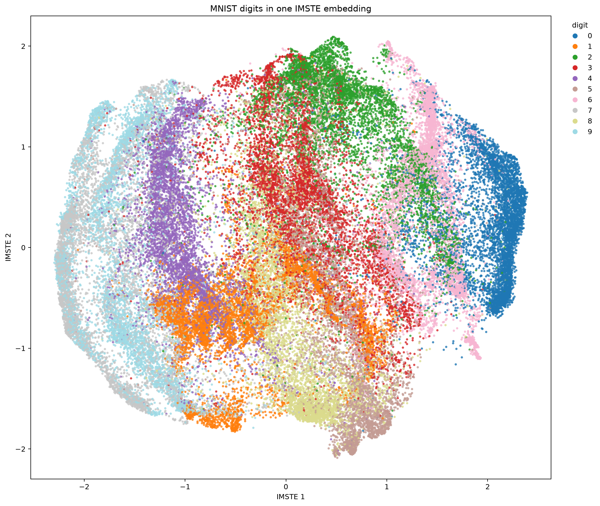
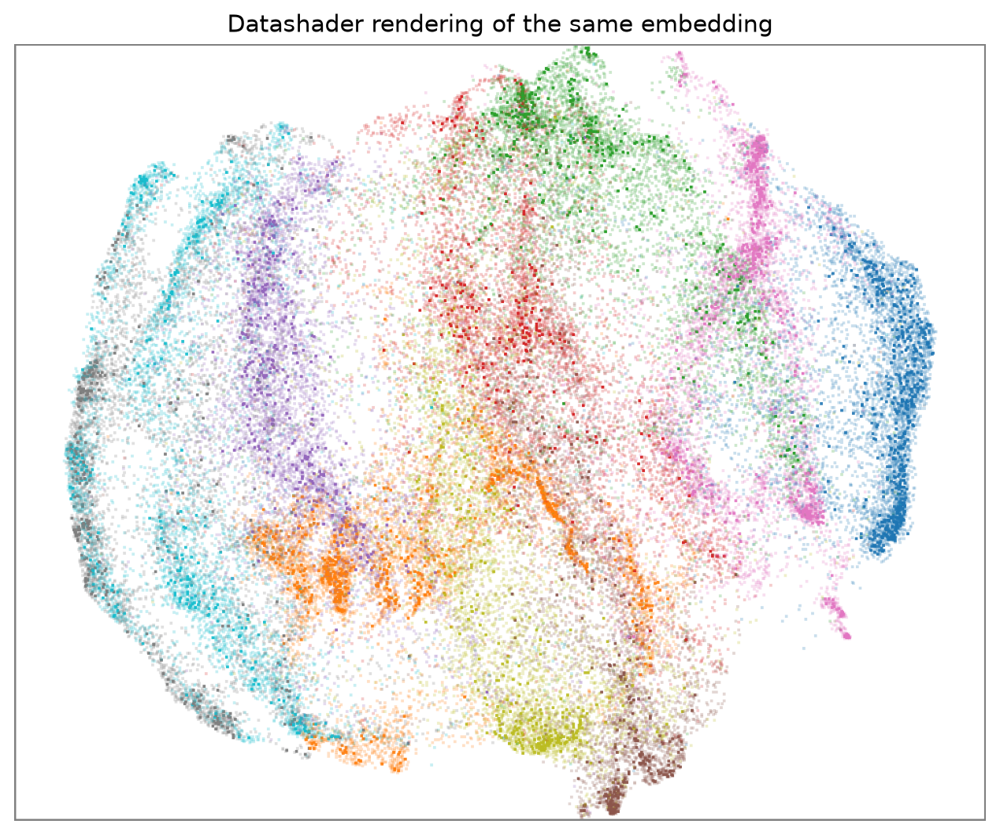
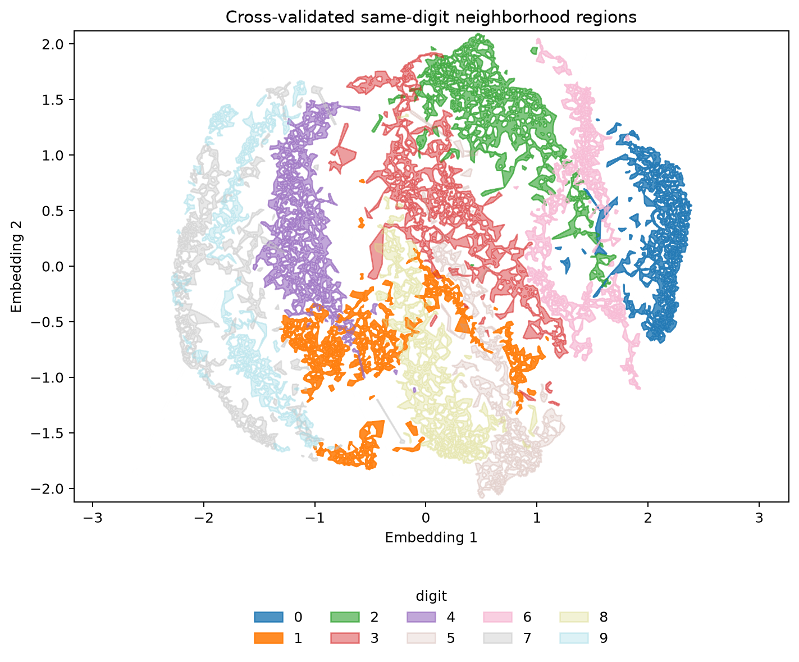
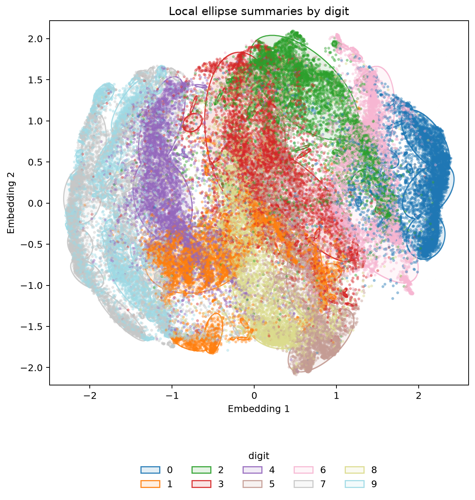
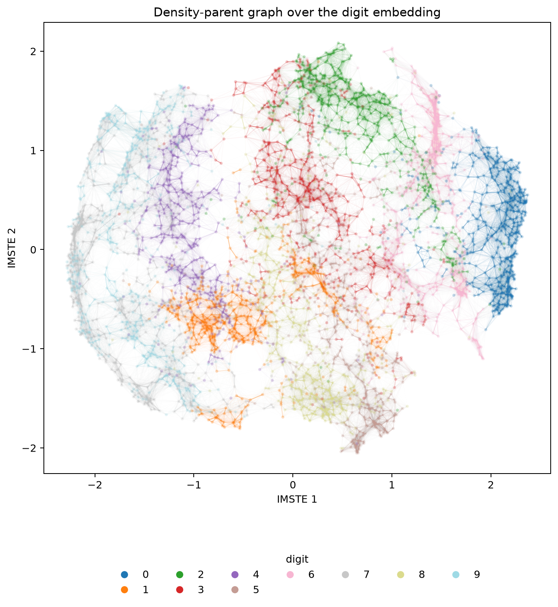
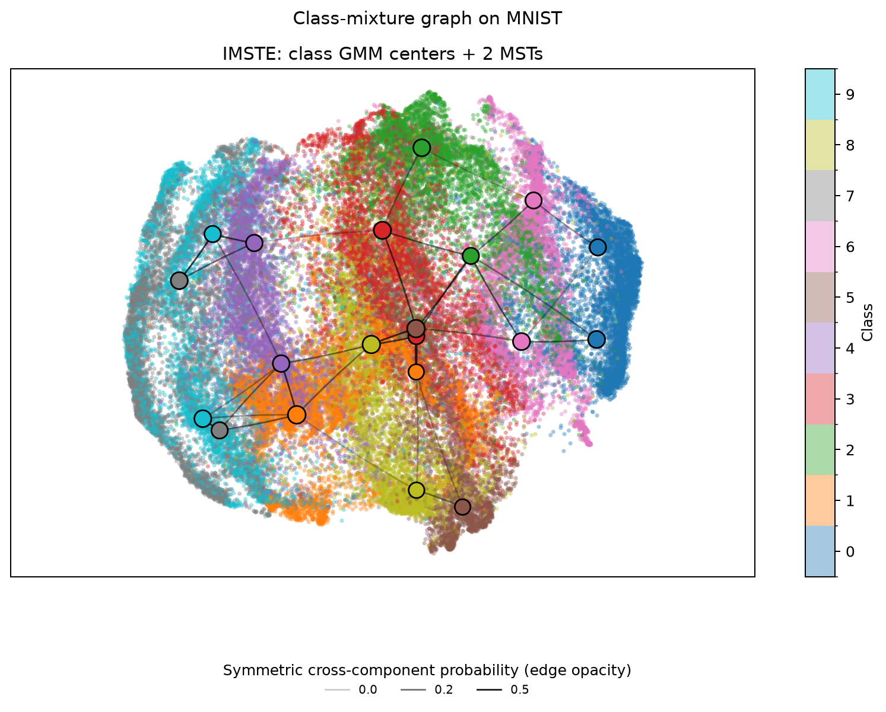
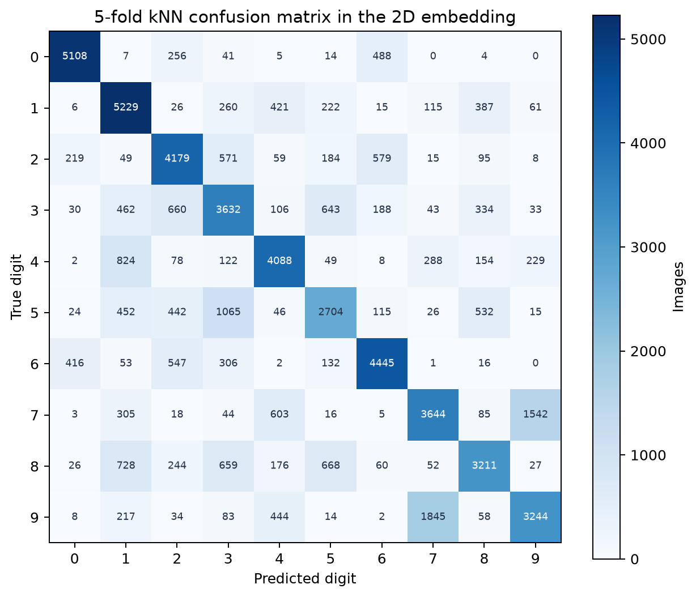

# Visualizing IMSTE embeddings

A two-dimensional embedding is easier to understand when it is viewed in a few different ways. This gallery uses the complete **60,000-image MNIST training set**, fits IMSTE once, then reuses the same coordinates in each visualization. Digit labels are used for coloring and post-fit evaluation; they are not passed to the embedding fit.

The figures below are generated by the runnable [MNIST visualization notebook](../notebooks/visualization_guide.ipynb). It loads the local MNIST cache when available and otherwise downloads the data from OpenML. The dataset itself is not included in this repository. Install the plotting dependencies with:

```bash
python -m pip install "imste[notebook]"
```

## At a glance

| Helper | What it shows | Output |
| --- | --- | --- |
| `plot_embedding` | Sample positions colored by labels or metadata | Matplotlib figure and axes |
| `render_datashader_embedding` | Rasterized point density or categorical labels | Datashader image |
| `plot_knn_union` | Cross-validated same-label local neighborhoods | Matplotlib figure and axes |
| `plot_ellipses` | Compact summaries of selected local class regions | Matplotlib figure and axes |
| `plot_density_parent_tree` | Connections from points to nearby denser points | Matplotlib figure and axes |
| `plot_class_mixture_mst` | A graph between Gaussian mixture components of different classes | Figure, axes, and edge-score table |
| `interactive_force` | Interactive label-guided adjustment of coordinates | Jupyter widget |
| `cross_validate_embedding_knn` | Predictability of labels from the 2D embedding | Metrics, predictions, and confusion matrix |

## The embedding used throughout

The notebook selects 50 examples per digit with a fixed random seed, standardizes the pixel features, and fits a single 2D IMSTE layout. Its starter cell is:

```python
mapper = IteratedMinimumSpanningTreeEmbedder(
    n_msts=3, n_epochs=25, random_state=42, mst_neighbors=12
)
Z = mapper.fit_transform(X)
```



## Render the same coordinates in different ways

### `plot_embedding`

Use this as the reference view. It accepts a label vector, Series, or metadata DataFrame and can color by one or more metadata columns.

```python
from imste.visualization import plot_embedding

fig, axes = plot_embedding(Z, obs, label_key="digit")
```

### `render_datashader_embedding`

Datashader rasterizes point density or categories into an image. It helps when a scatter plot becomes visually crowded, and is useful for larger embeddings.



```python
from imste.visualization import render_datashader_embedding

image = render_datashader_embedding(Z, obs, label_key="digit", width=1000, height=800)
image.to_pil()  # display or save with Pillow
```

### `plot_knn_union`

This plot outlines cross-validated local neighborhoods whose samples share a label. It highlights locally coherent regions rather than one global boundary per digit.



```python
from imste.visualization import plot_knn_union

fig, ax = plot_knn_union(Z, obs, label_key="digit", k=5, cv_splits=5)
```

### `plot_ellipses`

Ellipses summarize selected local regions. They provide a compact view of spread and overlap; treat them as descriptive summaries, not as class decision boundaries.



```python
from imste.visualization import plot_ellipses

fig, ax = plot_ellipses(Z, obs, label_key="digit", k=5, cv_splits=5)
```

### `plot_density_parent_tree`

This plot links observations toward nearby points with higher estimated density. Fading cross-label edges helps compare the density structure with known digit labels.



```python
from imste.visualization import plot_density_parent_tree

fig, ax = plot_density_parent_tree(Z, obs, label_key="digit", k=30)
```

### `plot_class_mixture_mst`

This helper fits Gaussian mixture components within each class and connects components from different classes with iterated MST edges. Edge opacity reflects estimated component overlap. It returns the edge scores as a DataFrame for inspection.



```python
from imste.visualization import plot_class_mixture_mst

fig, axes, edge_scores = plot_class_mixture_mst(
    X, y, {"IMSTE": Z}, n_msts=2, max_components_per_class=2
)
```

### `interactive_force`

In a Jupyter notebook, this widget lets you adjust same-label attraction, different-label repulsion, neighborhood size, and how much of the adjusted layout to show. It starts from the fitted coordinates and does not refit IMSTE.


Run the interactive cell in the [notebook](../notebooks/visualization_guide.ipynb) to use the live controls.

## Evaluate the layout

### `cross_validate_embedding_knn`

This helper is an evaluation function rather than a plot. It runs stratified cross-validation using only the 2D coordinates and returns accuracy, balanced accuracy, predictions, and a confusion matrix. A high score means labels are locally predictable in this embedding; it does not establish that the embedding preserves every meaningful relationship in the original data.



```python
from imste.visualization import cross_validate_embedding_knn

scores = cross_validate_embedding_knn(Z, obs, label_key="digit", n_neighbors=5)
print(scores["accuracy"], scores["balanced_accuracy"])
```

## Run the complete example

Open [`notebooks/visualization_guide.ipynb`](../notebooks/visualization_guide.ipynb) for the complete workflow, including data loading, fitting, all plots, the interactive widget, and the evaluation matrix. It writes the static figures used on this page to `docs/images/`.
