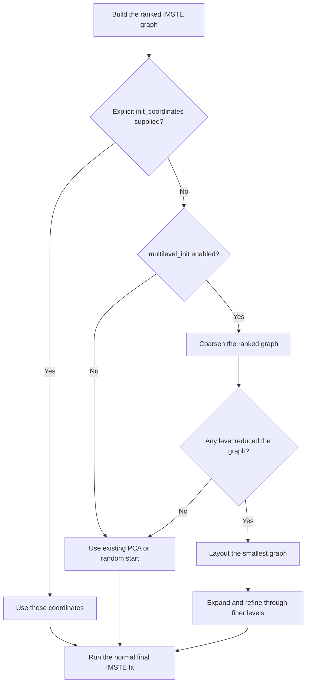
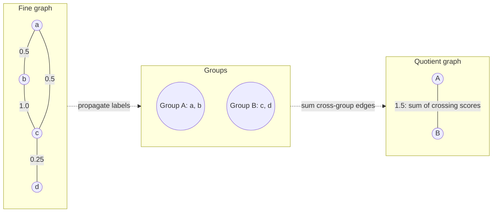
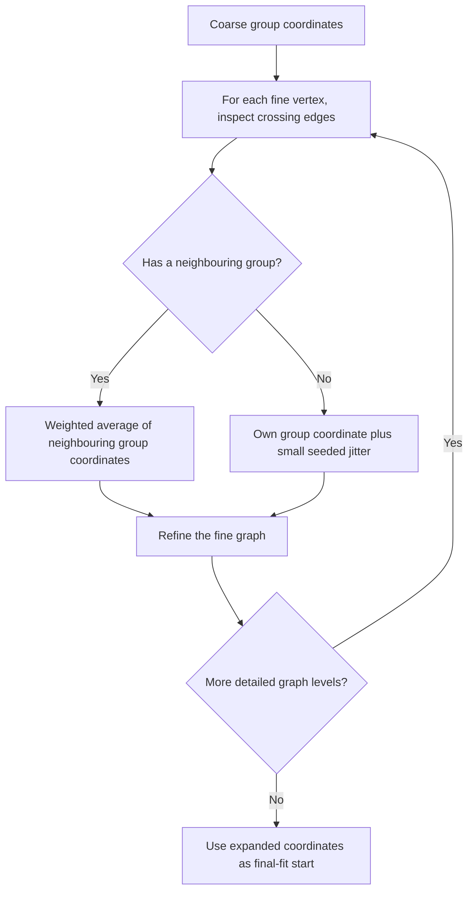

# Rank-only multilevel initialization for IMSTE

## What it does

Multilevel initialization builds a starting layout by working from a small graph up to the full IMSTE graph. It uses the fitted graph's vertices, edges, and ranks. It does not use the input feature distances again during coarsening.

The feature is optional. With the default `multilevel_init=False`, initialization continues to use the existing PCA or seeded random path. If you provide `init_coordinates`, those coordinates always take precedence and multilevel initialization is skipped.

The process has two phases:

1. Build smaller graphs by grouping nearby vertices and combining the weights of edges between groups.
2. Layout the smallest graph, then expand its coordinates back to the full graph and refine each level.



## Settings

| Setting | Default | Purpose |
| --- | ---: | --- |
| `multilevel_init` | `False` | Enable the multilevel starting layout |
| `multilevel_reduction_ratio` | `4` | Target roughly one group for every four current vertices per level |
| `multilevel_base_size` | `1024` | Stop coarsening when the graph has this many vertices or fewer |
| `multilevel_epochs` | `10` | Refine the layout for this many epochs at each coarse or expanded level |

The final optimization still uses the estimator's usual `n_epochs`, original ranked graph, and rank schedule. Multilevel epochs are additional work that prepares its initial coordinates.

## Step 1: Give each graph edge a score

For an edge with rank $r_e$, the score is its inverse rank:

$$
a_e = \frac{1}{r_e}
$$

A rank-one edge therefore has score $1$, a rank-two edge has score $1/2$, and so on. These scores guide the grouping and the coarse layouts. Original feature distances are not consulted during these steps.

## Step 2: Decide how many groups to make

Suppose the current graph has $N$ vertices and its connected components are already known. The target number of groups is roughly $\lceil N/q\rceil$, where $q$ is `multilevel_reduction_ratio`. The target is raised when necessary so every connected component can have at least one group.

The target is a guide. The number of groups can be higher if several disconnected components need separate groups. If every vertex must remain in its own group, that level did not reduce the graph and coarsening stops.

## Step 3: Pick seed vertices

The algorithm gives each vertex a weighted degree: add up the scores of its incident edges.

$$
h(i) = \sum_{e\ni i} a_e
$$

It visits vertices in descending weighted-degree order, breaking ties by vertex number. It prefers a seed that is not directly connected to a seed already selected. This spreads seeds across the graph. If that preference does not produce enough seeds, it fills the remaining slots in the same deterministic order. It also adds a seed to any connected component that still has none.

Each seed starts one group. Seeds are sorted before group numbers are assigned, so later tie-breaking is repeatable.

## Step 4: Grow the groups by label propagation

Every vertex starts with the label of its seed, or with no label yet. Propagation happens in rounds. In each round, an unlabelled vertex looks at its already-labelled neighbours and totals the edge scores belonging to each neighbour group:

$$
v(i,C) = \sum_{e=(i,j):\,j\in C} a_e
$$

The vertex joins the group with the largest total. If totals tie, it joins the group with the lower group number. Updates in a round are synchronous: a vertex only sees labels that existed before that round began. This makes the result deterministic and lets labels spread out from the seeds in an orderly way.

Because each connected component gets a seed and there are no edges between components, a label cannot cross from one component to another.

## Step 5: Make the smaller, quotient graph

Each group becomes one vertex in the smaller graph. Edges whose endpoints now belong to the same group are dropped. For every pair of different groups, the algorithm adds up the scores of all edges crossing between them:

$$
W_{AB} = \sum_{e=(i,j):\,i\in A,\,j\in B} a_e
$$

The result, $W_{AB}$, is a direct attraction weight for the quotient edge. It is not a newly calculated MST rank.



The figure is schematic: all crossing edges between groups are combined into one weighted edge. Internal edges do not appear in the quotient graph.

## Step 6: Repeat coarsening until it should stop

The quotient graph becomes the input to the next coarsening level. The same steps repeat until either:

- the current graph has `multilevel_base_size` vertices or fewer; or
- a level cannot reduce the number of vertices.

If no level reduced the original graph, the estimator uses its regular PCA or random initialization instead. If one or more levels did reduce it but a later level cannot, it uses the smallest graph reached so far.


## Step 7: Lay out the smallest graph

The smallest graph starts from seeded random coordinates. Its weighted quotient edges are optimized for `multilevel_epochs`. At each coarse level, the CPU or MPS optimizer selected by the estimator uses the direct quotient edge weights, normalized by their total weight.

If the smallest graph has no edges, there is nothing to optimize at that level; the coordinate expansion steps still proceed.

## Step 8: Expand coordinates to the next finer graph

The algorithm moves from a coarse graph back to the graph level that produced it. Each fine vertex already knows the group it belongs to. For that vertex, the algorithm looks across its edges to neighbouring groups and takes a weighted average of those groups' coordinates. Let $w_e$ be the edge's weight at the current level: inverse rank on the original graph, or the summed quotient weight on a coarser graph.

$$
\bar y_i = \frac{\sum_{e=(i,j),\,g(j)\ne g(i)} w_e\,y_{g(j)}}{\sum_{e=(i,j),\,g(j)\ne g(i)} w_e}
$$

Here, $g(i)$ is the group containing vertex $i$, and $y_{g(j)}$ is the current coordinate of a neighbouring group. When at least one external group neighbour exists, this average becomes the vertex's initial coordinate. If there are no external group neighbours, the vertex starts close to its own group's coordinate, with small seeded jitter scaled to the current layout.

Then the optimizer refines that finer graph for `multilevel_epochs`. The same expansion and refinement steps repeat until coordinates exist for every original vertex.



## Step 9: Run the usual IMSTE optimization

The expanded coordinates initialize the estimator's regular final optimization. That fit uses the original vertices, edges, and ranks. It also keeps the existing rank scheduling and the caller's `n_epochs`; coarse graph weights do not replace or alter the final ranked objective.

## Try it

```python
from imste import IteratedMinimumSpanningTreeEmbedder

mapper = IteratedMinimumSpanningTreeEmbedder(
    n_msts=4,
    multilevel_init=True,
    multilevel_reduction_ratio=4,
    multilevel_base_size=1024,
    multilevel_epochs=10,
    n_epochs=400,
    random_state=42,
)
embedding = mapper.fit_transform(X)
```

To start from explicit coordinates instead, provide `init_coordinates`. This takes precedence even when `multilevel_init=True`.

## Notebook comparison

Notebook 03 compares three layouts: the UMAP reference, IMSTE initialized from the already computed UMAP coordinates, and IMSTE initialized through this multilevel process. The two IMSTE fits use matching graph and final optimizer settings, so the starting strategy is the intended comparison.

## How this relates to UMAP

UMAP's recursive initialization also groups vertices, lays out a smaller graph, and expands coordinates to finer graphs. This implementation uses that general pattern, but derives its graph scores from IMSTE ranks. It does not use UMAP's fuzzy graph weights. See the [UMAP recursive initialization documentation](https://umap-learn.readthedocs.io/en/latest/api.html#recursive-initialization).
